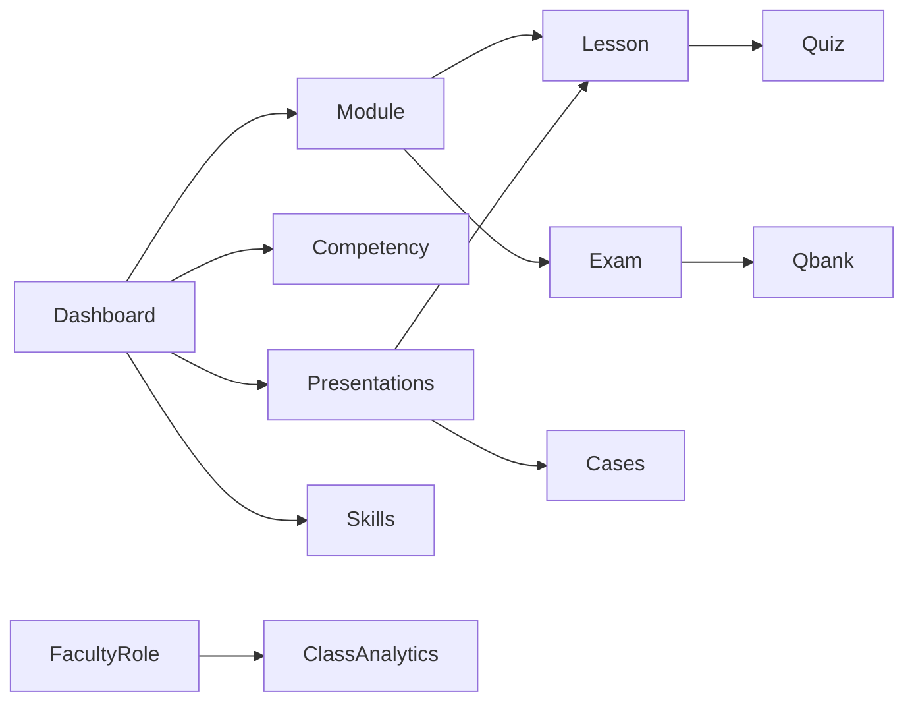

# UX / UI Audit

**Date:** 2026-10-27 · **Pass 2–3:** same day · **Pass 4:** 2026-10-28  
**Scope:** Student, faculty, and admin surfaces (App Router + shared shell)  
**Method:** Code inspection of routes, shell, players, gates, and copy; P0 then P1 remediations; pass 4 re-audit of practice/auth surfaces after skills + faculty analytics landed  
**Status:** Structural / interaction audit. Not a visual redesign or accessibility certification.

---

## 1. Surface map

| Role | Primary routes |
| --- | --- |
| Marketing | `/`, `/login`, `/signup`, `/invite/[token]` |
| Student | `/dashboard`, `/modules/[id]`, `/lessons/[id]`, `/competency`, `/presentations`, `/skills`, `/qbank`, `/flashcards`, `/cases`, `/tutor` |
| Faculty | `/dashboard` (class analytics when role=faculty), `/faculty`, `/faculty/flashcards`, `/faculty/questions`, `/faculty/lessons/[id]`, `/faculty/medical-review` |
| Admin | `/admin/analytics`, `/admin/invites`, `/admin/unlock-rules`, `/admin/users` (+ faculty + student view) |

Shared chrome: [`components/shared/app-shell.tsx`](components/shared/app-shell.tsx) + [`components/shared/app-nav.tsx`](components/shared/app-nav.tsx).

Design tokens: Fraunces + Source Sans 3; teal clinical palette in [`app/globals.css`](app/globals.css).

---

## 2. Findings (before → after this pass)

### P0 — fixed (passes 1–3)

| ID | Finding | Fix |
| --- | --- | --- |
| N1 | No mobile navigation (`nav` was `hidden md:flex`) | Client `AppNav` with Menu/Close disclosure |
| N2 | “Log in” always in student/faculty nav while demo session exists | Removed; “Switch account” near role switcher |
| N3 | Faculty/admin nav omitted Medical review | Added `/faculty/medical-review` to faculty + admin links |
| N4 | No active nav state | Pathname-aware active styles (desktop + mobile) |
| G1 | Qbank gate reasons leaked internal strings | Student-facing reasons only |
| C1–C3 | Raw role badges / Item vs Question / underused copy | Formatters + STUDENT_COPY wiring |
| V1–V2 | Marketing width / cases hover | Aligned to `max-w-6xl` + hover lift |
| A1–A3 | Role switcher name, skip-link, color-only progress | Labeled select, skip link, text+bar progress |

### P1 — fixed in pass 2–3

| ID | Finding | Fix |
| --- | --- | --- |
| N5–N6 | Nav crowding / role enum-only | Learn/Practice groups; `fullName (role)` |
| L1–L2 | Lesson density / competency overflow | Sticky sidebar + scroll hint |
| F1–F2 | Faculty objectives dump / sticky save | Filter/paginate + sticky dirty save |
| AD1 | Admin unlock jargon | Student-voice labels |

### P1 — fixed in pass 4 (2026-10-28)

| ID | Finding | Fix |
| --- | --- | --- |
| T1 | Tutor lesson `<select>` unusable with hundreds of lessons | Search filter + capped option list |
| T2 | Tutor empty state / “Expert posture” jargon | Starter prompts + student “how to ask” tips |
| T3 | Tutor composer awkward on mobile | Stacked composer; Enter-to-send; live “thinking” |
| K1 | Cases index is a flat unfilterable wall | Search + Progressive/Free-text filters |
| A4 | Login/signup lacked brand chrome | `AuthChrome` with Online MD mark + home link |
| D2 | Ad-hoc card borders duplicated | Shared `SurfaceCard` primitive |
| D5 | Form controls inconsistent (bg/focus) | Global `.field-control` styles |
| H1 | Marketing hero overstuffed (extra supporting paragraph + weak brand) | Brand-forward hero; one subhead; removed duplicate body |
| S1 | Page intros used `-mt-4` hacks under titles | `AppShell` optional `description` prop |

### P2 — later

| ID | Finding |
| --- | --- |
| D1 | Only Button + Badge (+ Card) primitives; many Radix deps unused vs IMPLEMENTATION_PLAN “shadcn” |
| D3 | Product tours / mock-exam UX (MT.vn P2) not built |
| D4 | Dark mode not supported (fine; avoid accidental drift) |
| N7 | Desktop Learn cluster is dense (Dashboard/Competency/Presentations/Skills) — watch for overflow on 1024px |
| T4 | Tutor still loads full lesson catalog client-side; consider server search later |

---

## 3. Interaction patterns (current)

- Progress language: Not started / In progress / Complete (avoid “locked” / “mastered” in student UI).
- Gates: disabled CTA + reason text; mastery logic unchanged.
- Practice: learn-first copy on qbank; competency scores labeled study evidence.
- Faculty demo role: `/dashboard` → class analytics & remediation (mock cohort).

---

## 4. Intentionally unchanged

- Mastery thresholds, unlock rules, scoring, auth.
- Full visual redesign / new design system.
- WCAG certification (needs dedicated a11y pass with tooling).

---

## 5. Verification

- `npm test`, `npm run build`
- Manual: Faculty role → analytics dashboard; Student → learning dashboard; tutor lesson search; cases filters; login shows Online MD chrome
