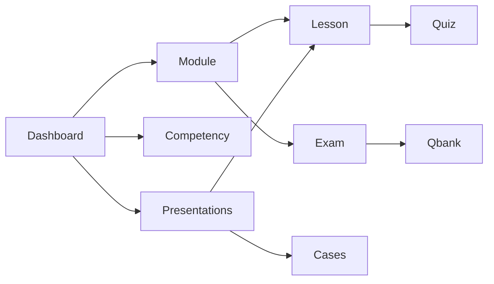

# UX / UI Audit

**Date:** 2026-10-27 · **Pass 3 (post medical+UX stack merge):** same day  
**Scope:** Marketing, student, faculty, admin (App Router + shared shell)  
**Method:** Code inspection of routes, shell, players, gates, and copy after `d33588d` (medical + UX stack on main)  
**Status:** Structural / interaction audit. Not a visual redesign, accessibility certification, or medical-content review.

---

## 1. Surface map

| Role | Primary routes |
| --- | --- |
| Marketing | `/`, `/login`, `/signup`, `/invite/[token]` |
| Student | `/dashboard`, `/modules/[id]`, `/lessons/[id]`, `/competency`, `/presentations`, `/qbank`, `/flashcards`, `/cases`, `/tutor` |
| Faculty | `/faculty`, `/faculty/flashcards`, `/faculty/questions`, `/faculty/lessons/[id]`, `/faculty/medical-review` |
| Admin | `/admin/analytics`, `/admin/invites`, `/admin/unlock-rules`, `/admin/users` (+ faculty + student view) |

Shared chrome: [`components/shared/app-shell.tsx`](components/shared/app-shell.tsx) + [`components/shared/app-nav.tsx`](components/shared/app-nav.tsx).

Design tokens: Fraunces + Source Sans 3; teal clinical palette in [`app/globals.css`](app/globals.css).

---

## 2. Already fixed (verified still present)

Prior remediations remain in the merge; re-checked on current tree:

| ID | Area | Evidence |
| --- | --- | --- |
| N1 | Mobile nav | `AppNav` Menu/Close disclosure (`md:hidden`) |
| N2 | Auth chrome | “Switch account” near role switcher; no always-on “Log in” in shell |
| N3 | Faculty/admin Medical review | Links in `facultyLinks` / `adminLinks` |
| N4 | Active nav | Pathname-aware styles desktop + mobile |
| N5 | Student nav density | Learn / Practice groups + separators |
| N6 | Role switcher labels | `fullName (role)` options + `aria-label="Demo role"` |
| G1 | Qbank gate reasons | Student-facing strings in `lib/mastery/gates.ts` (no “Rule inactive”) |
| C1 | Educational role badges | `formatEducationalRole()` |
| C2 | Question numbering | Quiz + exam use “Question N” |
| C3 | STUDENT_COPY | Wired on home / dashboard / qbank / module / presentations / competency |
| V1 | Width alignment | Marketing + app `max-w-6xl` |
| V2 | Cases hover | Matches presentations/dashboard lift |
| A1–A3 | A11y foundations | Skip link, `:focus-visible`, lesson progress text + bar |
| L1 | Lesson player chrome | Sticky sidebar, section progress, reviewed dots |
| L2 | Competency overflow | Mobile scroll hint + horizontal scroll |
| F1 | Objectives table | Search, module filter, 25/page |
| F2 | Lesson editor save | Sticky bar, dirty detection, `beforeunload` |
| AD1 | Unlock-rules panel labels | Student-voice scope/state; “On for students” |

---

## 3. New findings (still open)

### P0

| ID | Role | Route / component | Finding | Recommendation |
| --- | --- | --- | --- | --- |
| G2 | Student | `/modules/[moduleId]` · `app/modules/[moduleId]/page.tsx` | Gate CTA still says **“Locked”** while product language (and qbank GateCards) use “Not yet available” / reason text. Violates the established rule: avoid “locked” in student UI. | Replace disabled label with **“Not yet available”** (or omit the dead button and keep reason-only). Align with `STUDENT_COPY.qbankLockedModule` / `QbankPanel` GateCard. |
| S1 | Student | `/lessons/[lessonId]` · `app/lessons/[lessonId]/page.tsx` | Sources footer exposes process jargon: “reference review required” and “not yet medically approved”. Students see faculty QA status, not study guidance. | Student footer: show verified citations only; if none verified, use neutral copy (“Sources being verified”) without review-status enums. Keep raw status on faculty medical-review only. |

### P1

| ID | Role | Route / component | Finding | Recommendation |
| --- | --- | --- | --- | --- |
| N7 | All | `components/shared/app-nav.tsx` | Mobile menu: no Escape-to-close, no outside-click dismiss, no focus move into panel / restore on close. | Close on Escape + outside click; focus first link on open; return focus to Menu button on close. |
| N8 | Admin | `components/shared/app-shell.tsx` + `/admin/unlock-rules` | Nav label **“Access rules”** vs page title **“Unlock rules”** (`app/admin/unlock-rules/page.tsx`) and analytics link “Unlock rules”. | Unify to one term (prefer **Access rules** to match panel student voice) in nav, `AppShell` title, and analytics cross-links. |
| N9 | Admin | `app-shell` adminLinks | Seven flat admin links (Analytics, Invites, Access rules, Users, Curriculum, Medical review, Student view) with no grouping — denser than student Learn/Practice. | Group Admin / Content / Views (same pattern as student groups) or drop redundant cross-links already reachable from Curriculum. |
| G3 | Student | `/dashboard` · `app/dashboard/page.tsx` | Step 1 / Step 2 CK badges omit status when gated — only show “· Available” when unlocked, so locked state reads like a feature chip with no meaning. | Add “· Not yet available” (or hide until unlocked) and optionally link to `/qbank`. |
| G4 | Student | `components/student/exam-runner.tsx`, `qbank-panel.tsx` | Exam / qbank submit allowed with zero or partial answers; lesson `QuizRunner` correctly requires all answers. | Mirror quiz guard: disable submit until every question has a choice (or confirm “Submit unanswered?”). |
| A4 | Student | `components/ui/badge.tsx` · `ProgressBar` | Shared `ProgressBar` has no `role="progressbar"` / `aria-*` (lesson player bar does). Used on dashboard + module + admin analytics. | Add the same progressbar semantics as `lesson-player.tsx` (and optional `aria-label`). |
| A5 | Student | `components/student/case-player.tsx` | Stage response `<textarea>`s have no associated `<label>` / `aria-label` (prompt is a `
` only). | Wire `<label htmlFor>` or `aria-label={stage.prompt}` on each textarea. |
| A6 | Student | `components/student/flashcard-deck.tsx` | Recall quality controls are bare `0`–`5` buttons with no accessible names beyond the digit. | `aria-label` e.g. “Quality 0 — blank” … “Quality 5 — perfect”; consider text labels on `sm+`. |
| A7 | Student | `components/student/competency-heatmap.tsx` | Cells are color + number; accessible name is effectively the bare percent (title attribute only). Domain header ternary always uses SHORT labels. | Give links accessible names including domain + module (`aria-label`); use full labels when `!compact`. |
| L3 | Student | `components/student/lesson-player.tsx` | On viewports `<lg`, the full section TOC stacks **above** reading pane — long lessons push content far down. | Collapse TOC into a disclosure (“Lesson sections”) on small screens; keep sticky sidebar at `lg+`. |
| L4 | Student | `components/student/lesson-player.tsx` | Sidebar lists blocks under empty concept `<li>` wrappers — concept titles never render, so hierarchy is invisible. | Show concept title as a non-interactive subheading above its blocks. |
| E1 | Student | `components/student/flashcard-deck.tsx` | Empty catalog (`cards.length === 0`) shows “You’re caught up…” — same as “all due reviewed”. | Distinct empty: “No flashcards yet” vs caught-up. |
| E2 | Student | `/presentations` · `app/presentations/page.tsx` | No empty state if filtered problems list is empty; index also omits `presentationsDisclaimer` present on detail. | Add empty copy; show disclaimer on index for consistency with detail. |
| E3 | Student | `/competency` · `app/competency/page.tsx` | When `gaps.length === 0`, “Suggested focus” is omitted with no onboarding empty for a cold heatmap. | Show the same empty as dashboard widget (“Complete a few lessons…”) above the map. |
| T1 | Student | `/tutor` · `components/student/tutor-chat.tsx` | Aside “Expert posture” lists **“Enable AI_ENABLED + AI_API_KEY for live model”** — env/dev jargon in student UI. | Student-facing: “Answers use lesson context; live AI when configured.” Move env hint to faculty/admin or docs. |
| F3 | Faculty | `/faculty` · `app/faculty/page.tsx`, `faculty-library.tsx` | Intro says “edit content blocks”; library lines expose “N blocks” and raw `mod.status`. Filter input has no visible/`aria` label; no empty state when filter matches nothing. | Prefer “sections”; humanize status; label the filter; “No lessons match this filter.” |
| F4 | Faculty | `/faculty/questions` · `app/faculty/questions/page.tsx`, `question-editor.tsx` | Student-avoided “formative” + “Zod-validated” appear in faculty chrome (“New formative question”, save toast). | Faculty can keep technical terms lightly, but prefer “Lesson quiz question” / drop Zod from page blurb. |
| F5 | Faculty | `/faculty/lessons/[id]` · `lesson-editor-form.tsx` | Blocks show raw `blockType` snake_case + internal `block.id`; pass threshold is raw `0.7` with weak framing; sticky save can cover tagged objectives below (`pb-24` helps but objectives sit under editor). | Humanize type labels (`formatBlockType`); hide ids behind “Advanced”; show threshold as percent; keep objectives above sticky zone or in a side panel. |
| F6 | Faculty | `medical-review-dashboard.tsx` | Actions column stacks Open / Edit / Approve / Request changes / Mark for review with no confirm — high mis-click risk; “Open” goes to student lesson (`/lessons/...`). | Confirm destructive/status changes; primary row actions only; label Open as “Student preview”. |
| D5 | Student | `/dashboard` · `reset-progress-button.tsx` | “Reset my progress” is one click, no confirm — destroys demo mastery state. | Confirm dialog (“Reset all lesson and assessment progress?”). |
| D6 | Marketing | `/` · `app/page.tsx` | Hero has brand-as-eyebrow + tagline H1 + **two** supporting paragraphs + dual CTAs — denser than the one-headline / one-support pattern; brand is weaker than the tagline. | One support sentence; make “Online MD” display-sized in hero (or H1 = brand + subhead = tagline). |

### P2

| ID | Role | Route / component | Finding | Recommendation |
| --- | --- | --- | --- | --- |
| D1 | All | `components/ui/*` | Still only Button + Badge/ProgressBar primitives; Radix deps unused vs IMPLEMENTATION_PLAN shadcn path. | Defer until design-system pass; or add shared Card/Input. |
| D2 | All | Surfaces | Card pattern duplicated ad hoc (`rounded-xl border …`). | Extract shared Card when touching multiple pages. |
| D3 | Student | Practice | Product tours / mock-exam UX (MT.vn P2) not built. | Out of scope for this pass. |
| D4 | All | `globals.css` | No dark mode (intentional). | Keep; avoid accidental dark drift. |
| N10 | All | `app-shell.tsx` | Logo always links to marketing `/`; authenticated users lose in-app home. | Point logo to role home (`/dashboard`, `/faculty`, `/admin/analytics`). |
| N11 | All | `app-shell.tsx` | Role switcher + “Switch account” both change identity — redundant chrome on small screens. | Keep switcher; move “Switch account” into mobile menu overflow. |
| Q1 | Student | `qbank-panel.tsx` | Module `<select>` lacks explicit `aria`-friendly name beyond wrapping label; three GateCards + selector can feel redundant when starting a module set. | Once a module set starts, collapse gate cards or scroll session into view with `aria-live`. |
| Q2 | Student | `quiz-runner.tsx` | Zero-question edge: submit enablement `0 < 0` is false so Submit stays enabled. | Disable when `questions.length === 0`; show empty copy. |
| AD2 | Admin | `/admin/unlock-rules` page blurb | Still says “Pedagogical gates” / “unlock path” while panel UI was softened. | Match panel voice: “Turning a rule off hides that question bank for students.” |
| AD3 | Admin | `/admin/analytics` | Shows “unlocked” / student gate reasons mixed; ProgressBars unlabeled for a11y (see A4). | Admin-neutral status (“Available” / “Blocked”) + A4. |
| M1 | Module | `/modules/[id]` | Assessment CTA duplicated (summary card + bottom strip). | Keep one primary assessment CTA. |

---

## 4. Interaction patterns (current)

- Progress language: Not started / In progress / Complete (avoid “locked” / “mastered” in student UI) — **G2 still violates**.
- Gates: disabled CTA + reason text; mastery logic unchanged.
- Practice: learn-first copy on qbank; competency scores labeled study evidence.

---

## 5. Intentionally unchanged

- Mastery thresholds, unlock rules, scoring, auth.
- Full visual redesign / new design system.
- Medical content accuracy (separate audits).
- WCAG certification (needs dedicated a11y pass with tooling).

---

## 6. Suggested fix order

1. **G2 + S1** — student gate/source copy (P0).
2. **N7, A4–A7, L3** — mobile nav + a11y + lesson TOC (P1).
3. **N8/N9, G3/G4, T1, E1–E3, D5** — consistency, empty states, tutor jargon, reset confirm.
4. **F3–F6, AD2/AD3** — faculty/admin density and labels.
5. **P2** backlog when touching those surfaces.
