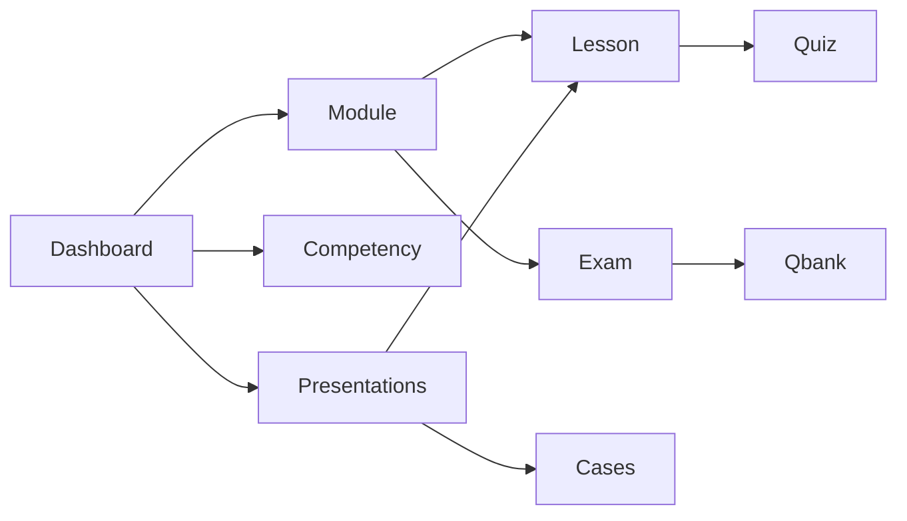

# UX / UI Audit

**Date:** 2026-10-27 · **Pass 2:** same day  
**Scope:** Student, faculty, and admin surfaces (App Router + shared shell)  
**Method:** Code inspection of routes, shell, players, gates, and copy; P0 then P1 remediations  
**Status:** Structural / interaction audit. Not a visual redesign or accessibility certification.

---

## 1. Surface map

| Role | Primary routes |
| --- | --- |
| Marketing | `/`, `/login`, `/signup`, `/invite/[token]` |
| Student | `/dashboard`, `/modules/[id]`, `/lessons/[id]`, `/competency`, `/presentations`, `/qbank`, `/flashcards`, `/cases`, `/tutor` |
| Faculty | `/faculty`, `/faculty/flashcards`, `/faculty/questions`, `/faculty/lessons/[id]`, `/faculty/medical-review` |
| Admin | `/admin/analytics`, `/admin/invites`, `/admin/unlock-rules`, `/admin/users` (+ faculty + student view) |

Shared chrome: [`components/shared/app-shell.tsx`](components/shared/app-shell.tsx) + [`components/shared/app-nav.tsx`](components/shared/app-nav.tsx).

Design tokens: Fraunces + Source Sans 3; teal clinical palette in [`app/globals.css`](app/globals.css).

---

## 2. Findings (before → after this pass)

### P0 — fixed

| ID | Finding | Fix |
| --- | --- | --- |
| N1 | No mobile navigation (`nav` was `hidden md:flex`) | Client `AppNav` with Menu/Close disclosure |
| N2 | “Log in” always in student/faculty nav while demo session exists | Removed; “Switch account” near role switcher |
| N3 | Faculty/admin nav omitted Medical review | Added `/faculty/medical-review` to faculty + admin links |
| N4 | No active nav state | Pathname-aware active styles (desktop + mobile) |
| G1 | Qbank gate reasons leaked internal strings (`Rule inactive`, concatenated mastery reasons) | Student-facing reasons only in `canAccessModuleQbank` / Step 1 missing-curriculum copy |
| C1 | Educational role badges showed `CLINICAL APPLICATION` raw | `formatEducationalRole()` |
| C2 | Exam runner said “Item N”; quizzes said “Question N” | Unified to “Question N” |
| C3 | `STUDENT_COPY` underused on home/dashboard/qbank/module | Wired taglines and qbank/module CTAs |
| V1 | Marketing `max-w-5xl` vs app `max-w-6xl` | Home hero/header aligned to `max-w-6xl` |
| V2 | Cases cards lacked hover lift used elsewhere | Matched presentation/dashboard hover |
| A1 | Role switcher select lacked accessible name | `aria-label="Demo role"` |

### P1 — fixed in pass 2

| ID | Finding | Fix |
| --- | --- | --- |
| N5 | Eight student nav items compete on desktop | Grouped **Learn** / **Practice** with separators |
| N6 | Role switcher showed role enum only | Options show `fullName (role)` |
| L1 | Lesson player dense | Sticky sidebar, section progress bar, reviewed dots |
| L2 | Competency heatmap overflow | Mobile scroll hint + existing horizontal scroll |
| F1 | Faculty objectives dumped 3k+ rows | Search, module filter, 25/page pagination |
| AD1 | Admin unlock-rules system jargon | Student-voice scope/state labels (“On for students”) |
| A2 | No skip-link / weak focus | Skip to content + global `:focus-visible` |
| A3 | Color-only progress | Lesson progress pairs bar % with “N of M reviewed” text |

### P1 — still open

| ID | Finding | Recommendation |
| --- | --- | --- |
| F2 | Faculty editors are form-heavy without sticky save | Sticky save bar + unsaved warning |

### P2 — later

| ID | Finding |
| --- | --- |
| D1 | Only Button + Badge primitives; unused Radix deps vs IMPLEMENTATION_PLAN “shadcn” |
| D2 | Card pattern duplicated ad hoc (no shared Card component) |
| D3 | Product tours / mock-exam UX (MT.vn P2) not built |
| D4 | Dark mode not supported (fine; avoid accidental drift) |

---

## 3. Interaction patterns (current)

- Progress language: Not started / In progress / Complete (avoid “locked” / “mastered” in student UI).
- Gates: disabled CTA + reason text; mastery logic unchanged.
- Practice: learn-first copy on qbank; competency scores labeled study evidence.

---

## 4. Intentionally unchanged

- Mastery thresholds, unlock rules, scoring, auth.
- Full visual redesign / new design system.
- Faculty content editing workflows beyond nav discoverability.
- WCAG certification (needs dedicated a11y pass with tooling).

---

## 5. Verification

- `npx tsc --noEmit`, `npm run lint`, `npm test`, `npm run mastery`, `npm run build`
- Manual: mobile Menu shows Learn/Practice groups; skip link focuses main; faculty objectives filter/paginate; lesson sidebar sticky with progress
