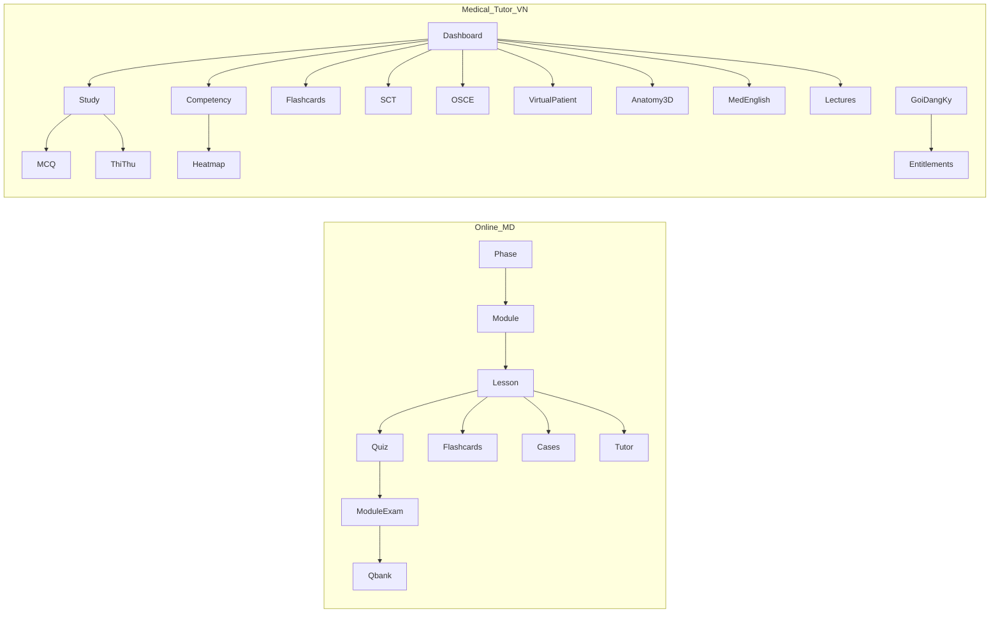

# Medical-tutor.vn vs Online MD — Structure Comparison Report

**Date:** 2026-10-27  
**Sources:** Live public surface of [medical-tutor.vn](https://medical-tutor.vn) (HTTP probes, `robots.txt`, Next.js page/tour JS, subscription copy) vs this repo (`app/`, `lib/curriculum/`, `docs/CURRICULUM.md`, `README.md`).

**Limits:** Authenticated study content on medical-tutor.vn is client-gated; curriculum depth inside paid walls was inferred from public tours, plan copy, and API path names—not from logged-in lesson text.

Related: [MT.vn capability prototype priorities](./MT_VN_CAPABILITY_PROTOTYPE_PRIORITIES.md).

---

## 1. Executive verdict

| Dimension | medical-tutor.vn | Online MD (this repo) |
| --- | --- | --- |
| Product thesis | Vietnamese **practice + competency** platform for clinical reasoning skills | US-style **4-year MD curriculum** with mastery before Qbank |
| Primary unit | Organ system → clinical problem → MCQ / SCT / OSCE / reading | Phase → Module → Lesson → Concept → Quiz → Exam → Qbank |
| Content spine | 17 organ systems × 12 competency domains × **128 clinical problems** | **884 lessons** across 22 modules (538 preclinical / 346 clinical) |
| Assessment | Mock exams (~3,000 free bank claimed), SCT, OSCE/virtual patient | Formative quiz → module exam → gated Step1/Step2 Qbank (24 items today) |
| Monetization | Subscription packs (`/goi-dang-ky`) | None in MVP (demo / institutional) |
| Locale | `lang="vi"`, Vietnamese-first UX + tours | English / USMLE framing |
| Stack | **Next.js** App Router (same family) | **Next.js 15** App Router + React 19 + Tailwind 4 |
| Clinical disclaimer | Meta: `clinical_use_approved=false` | Educational-only; medical review workflow emerging |

They look like **related product lineages** (shared Next.js patterns, flashcards, dashboard, admin), but **not the same information architecture**. Online MD is curriculum-first; Medical Tutor VN is skill/competency-first with richer clinical simulation surfaces.



---

## 2. Technology & delivery

### medical-tutor.vn

- Next.js (headers: `x-powered-by: Next.js`, `x-nextjs-cache`)
- Vietnamese HTML (`lang="vi"`), client-side routing (“Đang chuyển…”)
- Rich `/api/*` surface (study, competency, billing, admin MCQ, media, review)
- Public marketing/login; authenticated shells for study/admin
- Product tours embedded in layout JS (`PageTourHost`)

### Online MD

- Next.js 15.5 App Router + Turbopack, React 19, Tailwind 4, Zod
- Demo JSON store (`.data/`) + Supabase-ready schema
- Thin public API (`/api/health`); learning via server actions
- Faculty + admin layouts separate from student shell

**Similarity:** Both are Next.js App Router medical-learning apps.  
**Difference:** MT.vn has production billing APIs and many learning modalities; Online MD keeps a simpler demo/auth model and deeper authored curriculum graph.

---

## 3. Route / IA map

### medical-tutor.vn (from `robots.txt` + tours + page chunks)

| Area | Routes / surfaces |
| --- | --- |
| Auth / account | `/login`, account payment history paths |
| Home | `/dashboard` (“Hôm nay”) |
| Core study | `/study` (organ systems, 128 problems, MCQ), `/thi-thu` (mock exams) |
| Competency | `/competency` (heatmap profile) |
| Memory | `/flashcards`, `/flashcards/personal` |
| Clinical reasoning | `/chan-doan-sct` (Script Concordance Test) |
| Simulation | `/virtual-patient`, `/osce`, `/trinh-bay-ca` |
| Foundations media | `/giai-phau-sinh-ly` (anatomy–physiology + 3D), `/hoc/...` course paths |
| Lectures | `/lectures`, `/bai-giang/...` |
| Language | `/tieng-anh-y-khoa` |
| Classes | `/my-classes` |
| Feedback | `/feedback` |
| Billing | `/goi-dang-ky` |
| Admin | `/admin`, `/admin/users`, `/admin/feedback` |

`robots.txt` also hides `/.runtime-content/`, `/data/`, `/raw/`, `/reports/`, `/KM/`.

### Online MD (repo `app/`)

| Area | Routes |
| --- | --- |
| Auth | `/login`, `/signup`, `/invite/[token]` |
| Curriculum | `/dashboard`, `/modules/[moduleId]`, `/lessons/[lessonId]`, quizzes/exams |
| Practice | `/flashcards`, `/qbank`, `/cases/[caseId]`, `/tutor` |
| Faculty | `/faculty`, lesson editor, questions, flashcards, **`/faculty/medical-review`** |
| Admin | invites, users, unlock-rules, analytics |

**Absent on MT.vn (404 vs Online MD):** `/modules`, `/qbank`, `/cases`, `/tutor`, `/faculty`, `/signup`.  
**Absent on Online MD:** `/study`, `/competency`, `/thi-thu`, SCT, OSCE/VP, anatomy-3D hub, medical English, `/goi-dang-ky`, `/my-classes`.

---

## 4. Educational architecture

### Online MD — curriculum graph

```
Program → Phase (foundations | clerkship_core)
  → Module (organ system / clerkship)
    → Lesson (textbook chapter blocks)
      → Objectives → Formative quiz → Flashcards
    → Module exam
→ Qbank (unlock after mastery)
→ Clinical cases (thin staged)
```

- Design: **mastery gates** replace seat time ([`lib/mastery/gates.ts`](../lib/mastery/gates.ts))
- Content: seed + expansion waves + 771 catalog topics → **884 lessons** ([`CURRICULUM.md`](./CURRICULUM.md))
- Alignment: USMLE Step 1 / Step 2 CK domains
- Faculty medical-content review metadata (post-audit)

### medical-tutor.vn — competency / practice graph

Public copy repeatedly states:

- **17 organ systems**
- **12 competency domains** (heatmap columns)
- **128 clinical problems** (searchable problem bank under systems)
- Free Cardiology competency profile; paid unlock for all 17 systems
- Learning modes: MCQ practice, mock exam, SCT, lectures, flashcards, OSCE/VP, anatomy–physio 3D, medical English

Progress language emphasizes **evidence of practice** (“đủ bằng chứng”), not “module mastered → unlock Qbank.”

---

## 5. Feature-by-feature comparison

| Capability | medical-tutor.vn | Online MD |
| --- | --- | --- |
| Structured multi-year lessons | Course/lecture/paraclinical paths exist; not US 4-year MD map | Core strength (884 lessons) |
| Organ-system organization | Explicit 17-system study + competency map | Explicit Y1–Y2 organ modules + clerkships |
| Flashcards / spaced review | Yes (+ personal decks, due reviews) | Yes (SuperMemo2) |
| MCQ bank | Large; mock exam bank (claims 3,000 free) | Small qbank (24) + per-lesson formative |
| Mastery unlock to questions | Entitlements / system unlock / exam-bank lock APIs | Hard mastery gates before module/Step Qbank |
| AI tutor chat | Not evidenced as a first-class `/tutor` route | `/tutor` + case AI feedback |
| Clinical cases | SCT + virtual patient + OSCE + case presentation | Staged clinical cases (simpler) |
| Simulation / 3D | Anatomy–physio 3D, OSCE bedside tools, Bates stations | Not present |
| Medical English track | First-class pathway | Not present |
| Classroom / cohorts | `/my-classes` (join by code; instructor sees progress) | Not present |
| Faculty content editing | Admin MCQ/articles/media/review APIs | Faculty lesson/question/flashcard editors + medical review dashboard |
| Billing | Student/Pro/Faculty plans, checkout APIs | None |
| Guided onboarding tours | Extensive Vietnamese tours | Minimal |

---

## 6. Assessment & clinical reasoning

| | medical-tutor.vn | Online MD |
| --- | --- | --- |
| Formative | MCQ by system/problem | Lesson quizzes (≥80% typical) |
| Summative-ish | `/thi-thu` mock exams; weekly generation limits on free | Module exams |
| Reasoning under uncertainty | **SCT** (−2…+2 concordance) | Mostly MCQ + short cases |
| Performance skills | **OSCE / virtual patient** (exam, orders, meds, timed stations) | Not present |
| Board style | Vietnamese clinical training emphasis | Explicit Step1/Step2CK tagging |

Online MD is stronger as a **knowledge curriculum**. MT.vn is stronger as a **skills gym** (SCT/OSCE/VP).

---

## 7. Content & safety posture

- **MT.vn** meta description: educational system with `clinical_use_approved=false`. Tours warn competency scores are study metrics, not certification.
- **Online MD**: original USMLE-outline-aligned writing; recent medical-content audit, `REFERENCE_REVIEW_REQUIRED`, faculty medical-review queue; no claim of medical approval.

Neither product presents itself as a clinical decision tool.

---

## 8. What Online MD has that MT.vn appears to lack

1. Explicit **Program → Phase → Module → Lesson** 4-year MD map
2. **Mastery-before-Qbank** unlock philosophy
3. Dense **textbook-style lesson chapters** at scale (884)
4. Dedicated **Faculty AI tutor** route
5. **Medical content review** workflow for faculty
6. Clear **Step 1 vs Step 2** assessment ladder

## 9. What MT.vn has that Online MD lacks

1. **Competency heatmap** (17×12) with evidence-based next-study suggestions
2. **128 clinical-problem** practice taxonomy
3. **SCT**, **OSCE**, **virtual patient**
4. **3D anatomy/physiology** learning stations
5. **Medical English** pathway
6. **Subscription / entitlements**
7. **Classrooms** (`/my-classes`)
8. Production-scale **mock exam bank** UX
9. Vietnamese localization + product tours

---

## 10. Strategic interpretation

| If the goal is… | Better structural fit |
| --- | --- |
| Teach a full MD knowledge sequence with mastery | **Online MD** |
| Drill clinical problems, reasoning, OSCE-like skills in VN | **medical-tutor.vn** |
| Monetized consumer student product | **medical-tutor.vn** |
| Institutional curriculum + faculty governance | **Online MD** (directionally) |

They are **complementary**, not clones: Online MD = curriculum OS; Medical Tutor VN = competency/practice OS on the same general web stack.

---

## 11. Recommended follow-ups

Highest-leverage borrows from MT.vn into Online MD (without abandoning the mastery curriculum spine):

1. ~~Competency heatmap over existing modules~~ — **shipped** as `/competency` (study evidence, not certification)
2. ~~Clinical-problem index across clerkship content~~ — **shipped** as `/presentations`
3. SCT / OSCE as advanced case types — still open (P1)

Highest-leverage Online MD ideas for an MT-like product: deeper lesson graph and medical-review governance under the practice layers.

Prioritized prototype order: [MT_VN_CAPABILITY_PROTOTYPE_PRIORITIES.md](./MT_VN_CAPABILITY_PROTOTYPE_PRIORITIES.md).
